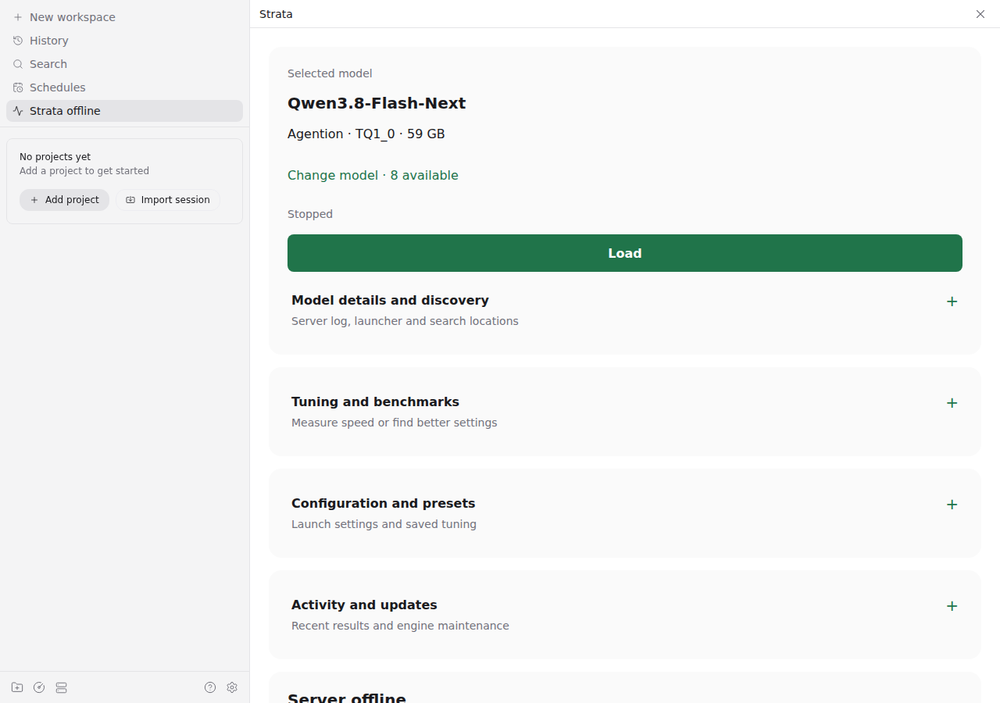
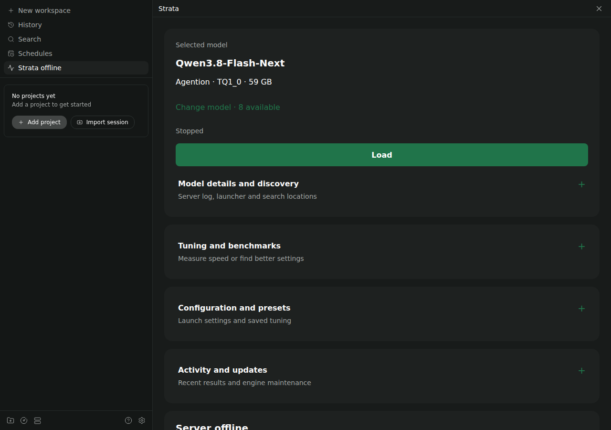
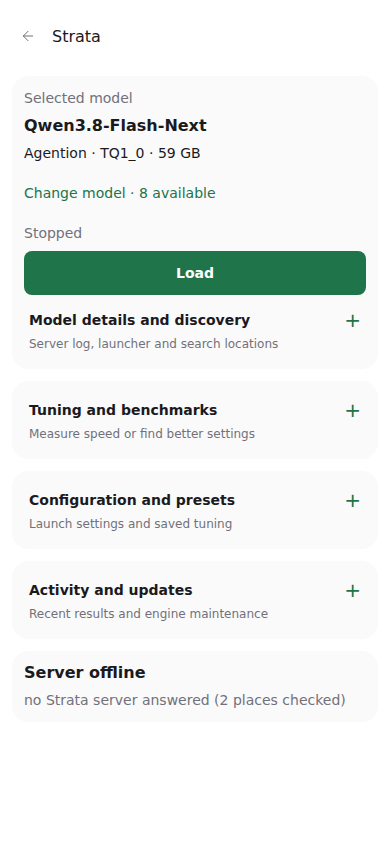
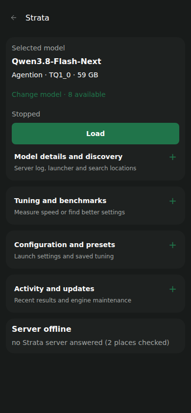

# Strata for Paseo

Find, load, benchmark and tune local [Strata](https://github.com/niko1221/strata) models from
[Paseo](https://paseo.sh), on desktop or phone. Edit model settings, manage saved tuning, and watch live speed
without leaving your workspace.

*Fresh capture of the current dashboard from the 18-check VM browser run: a stopped demo model and collapsed task cards.
Demo weights are empty; any reported speeds in fixture captures are synthetic.*

[Install](#install) · [Features](#features) · [Getting started](#getting-started) ·
[Safety](#safety-and-privacy) · [Documentation](#documentation) · [Development](#development)

## Install

```bash
paseo plugin add git:delirious6423/paseo-strata-monitor
```

**Requirements:** Paseo **0.12.0 or later**, an existing Strata install, and prepared model run configs.
The plugin discovers models; it does not download weights, pack models or install Strata.

**Platforms:** Linux x64/ARM64, Windows x64/ARM64 and macOS ARM64 have native VM coverage. Linux systemd
service control is Linux only. Remote servers can be monitored; model management operates on the daemon host.

The package version is **0.2.0**. Git installs from `main` also include the
[expanded dashboard changes](docs/releases/unreleased.md), not yet assigned a new release version.
Manage plugin updates in Paseo’s **Settings → Plugins**.

## Features

| Area | What you can do |
|---|---|
| **Models** | Discover existing models, choose by provider/family/size, Load, Abort, Stop, or recover an unknown state. Loading another model stops the previous one first. |
| **Live analytics** | See sidebar prefill/decode speed, a speed graph, queue, GPU/RAM use and recent requests. |
| **Autotune** | Choose Quick/Thorough, chat/coding, speed/room/reserve, time and RAM budgets, answer permissions, preset name, and save or measurement only. |
| **Benchmarks** | Choose six upstream suites with the controls each supports. Reports include throughput and latency; standard protocol conformance is reported separately. |
| **Model configuration** | Edit 30 guided settings or advanced JSON, with revision checks, private backups and atomic saves. Saving never starts a model. |
| **Saved tuning** | Inspect evidence, apply, switch off, undo, delete, re-check, rename, export/import JSON, and inspect effective settings. Imports stay inactive. |
| **Updates** | Check for signed Strata engine/control updates, install with progress, or undo the last engine update. Custom engine builds remain separate. |
| **Logs and idle stop** | Expand server logs and job details when needed. Optionally stop idle models after 15, 30, 60 or 120 minutes. |

The model list and task cards start collapsed; use **Change model** to open the picker. Live metrics lead
when online, with hardware/history optional. Form drafts survive closing sections and loading/stopping models.
Option panels, logs and job details also start collapsed, including after failures. Idle stop and answer-changing
tuning permissions are off by default. See [dashboard coverage](docs/dashboard-coverage.md) for exact controls
and deliberate exclusions.

## Getting started

### 1. Discover and load a model

Open **Strata** in Paseo, use **Change model** to choose a model, and press **Load**. **Abort** cancels a pending
load; **Stop** ends a running model. **Stop / recover unknown model** is available when its state cannot be established.

Discovery checks Strata’s remembered installs, `STRATA_INSTALL_DIR`, the desktop app’s install, and Linux
systemd user services. Add other run-config folders under **Settings → Plugins → Strata → Model discovery**.
A raw GGUF file alone is not a runnable entry.

### 2. Benchmark or tune

Open **Tuning and benchmarks** for these controls. Running jobs and Cancel stay visible outside the collapsed cards.

- **Benchmark:** load the selected model, expand benchmark options, choose a suite and confirm the run.
  Prompts and token counts are fixed by the suite, not editable free-form workloads.
- **Autotune:** Quick defaults to a 20-minute budget; Thorough defaults to two hours. Custom budgets are
  available. Small answer differences and nonrepeatable settings require separate opt-ins.
- **Save enabled:** a model that was ready is measured before and after tuning, with warmup and repeats.
  This is an uncontrolled sanity check, not proof of a performance gain.
- **Measurement only:** nothing is saved or applied. A previously ready model reloads its previous settings;
  a stopped model stays stopped. There is no misleading before/after comparison.

“No faster settings found” describes the search, not proof that the configuration is optimal. Unsupported
hardware, model or context settings may be skipped even in Thorough mode.

### 3. Configure models and presets

Open **Configuration and presets**. Stop all detected models before saving configuration. Resolve any unknown
status first. Review the draft, then save; the change takes effect on your next Load.

A **resource profile only selects the saved-tuning slot**: `full` uses speed, `work` uses room. It does not
reserve memory itself. A saved tuning goal must match this slot; measurement-only runs can explore either.

Guided settings such as **Speculative window** and **CPU pool workers** create deliberate overrides. If they
would shadow tuning candidates, Autotune and Re-check refuse to run. Restore **Default** or review advanced
JSON to remove those pins. Effective tuning shows the overrides applied after a preset.

Preset imports must match the selected slot and contain supported tuning settings. Importing never applies
a preset or restarts the model. Export redacts recognized credentials; review JSON before sharing it.

## Safety and privacy

- **No telemetry.** Monitoring talks to local Strata servers, addresses you add, and Strata’s saved connections.
  Update checks/installations use Strata’s CLI and signed feed.
- **Configuration writes fail closed.** A fresh status check, original SHA-256 and shared Load/Stop lock protect
  saves. Recognized credential-bearing configs, nonloopback binds and stale drafts are refused.
- **Backups are preserved by default.** The newest 10 plugin backups stay beside the config; older ones move
  to its archive. A separate, default-off checkbox permits irreversible deletion of older plugin backups,
  keeping 10 total. Consent resets after saving; legacy backups and unrelated files are untouched.
- **One workload at a time.** Load is refused while a tool owns the slot. Preset bookkeeping is allowed during
  benchmarks. Queued preset mutations can delay Stop by up to four 60-second CLI calls.
- **Credentials stay explicit.** Benchmark credential inputs accept `STRATA_` environment-variable names, not
  secret values. `/health` identifies a Strata-shaped service but does not authenticate it.

Advanced JSON can change engine behavior, and redaction cannot recognize arbitrary secrets hidden as neutral
text. Read the [operations and limitations guide](docs/operations.md) before changing advanced settings.

## Documentation

| Guide | Contents |
|---|---|
| [Dashboard coverage](docs/dashboard-coverage.md) | Available options, defaults, limits and safety boundaries |
| [Operations](docs/operations.md) | Discovery, launchers, credentials, storage, cancellation, updates and recovery |
| [Testing](TESTING.md) | Native platform matrix, regression scope, upstream contract checks and VM browser acceptance |
| [Changelog](CHANGELOG.md) | Current `main` changes and historical releases |
| [Expanded dashboard notes](docs/releases/unreleased.md) | What changed after 0.2.0 and migration guidance |
| [0.2.0 release notes](docs/releases/0.2.0.md) | Historical release snapshot |

## Screenshots

Current demo captures come from the same disposable-VM acceptance run. They show stopped demo models,
not a real inference or benchmark result. The phone views are browser viewports, not native iOS/Android apps.
Evidence and platform gaps are in [Testing](TESTING.md#screenshot-refresh-2026-10-26).

| Desktop, dark | Phone | Phone, dark |
|---|---|---|
|  |  |  |

Also available: [420×912 Air-sized phone view](assets/dashboard-phone-air.png). These are browser dimensions,
not a physical iPhone acceptance test. The compact layout preserves 44px minimum controls and 16px inputs.

Earlier 0.2.0 captures remain available for the [historical release notes](docs/releases/0.2.0.md):
[analytics](assets/screenshot.png), [tools](assets/phone-tools.png) and [discovery settings](assets/settings.png).

## Development

```bash
npm ci
npm run typecheck
bash tests/vm/run.sh
```

The full test suite launches HTTP/process fixtures: run it in disposable VMs, not against your live desktop.
The runners use the external dotfiles VM harness; prerequisites and all platform commands are in
[Testing](TESTING.md). The isolated upstream contract check can run without starting Strata.

[MIT license](LICENSE).
