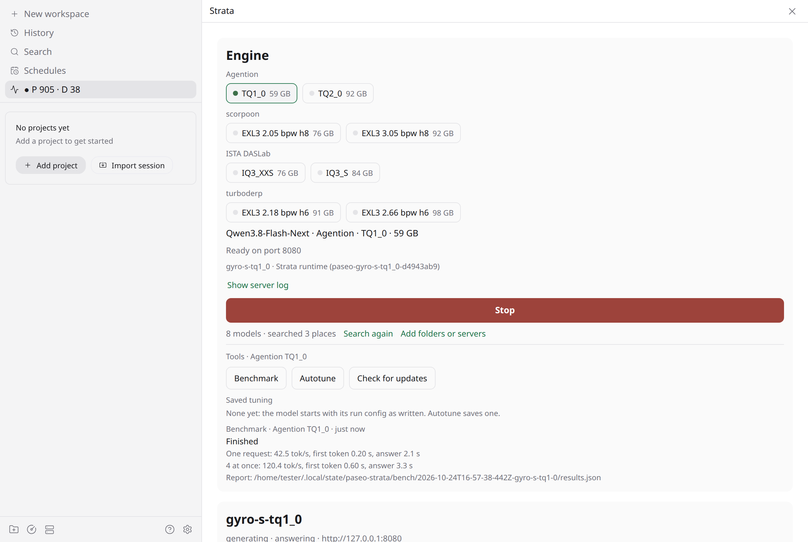

# Strata for Paseo

A [Paseo](https://paseo.sh) plugin for a local [Strata](https://github.com/niko1221/strata) inference server: find
the Strata models on your machine, load or stop one with a click, and watch the server's live speed and load.

- **Model picker**: every Strata model found on the machine, grouped by quant provider (and by model family when
  there are several), smallest first. Load, Abort while loading, Stop; loading one model stops the other first.
- **Live status**: an always-visible sidebar row with prefill and decode tok/s, and a screen with a speed graph,
  queue, GPU/RAM use and recent requests.

## Install

```bash
paseo plugin add git:delirious6423/paseo-strata-monitor
```

Requires Paseo 0.12.0 or later. Works on Linux, Windows and macOS.

## How it finds models

The same places Strata itself uses, read-only:

1. **Strata installs**: `STRATA_INSTALL_DIR` if set (then only that), else the installs remembered in Strata's
   settings file (`~/.config/strata/settings.json`, Windows `%APPDATA%\Strata\settings.json`) and the desktop
   app's install (`~/.local/share/strata/install`, Windows `%LOCALAPPDATA%\Strata\install`). Each holds
   setup-written `strata-<model>.json` run configs.
2. **Your own systemd user services** (Linux): a unit whose command, or the script it runs, passes
   `--config <run config>`, including template units such as `strata@.service` running `run-%i.sh`. Those models
   start and stop through their unit, so desktop shortcuts and Paseo agree. Turn off in the plugin settings.
3. **Extra folders** you add in Settings → Plugins → Strata → Model discovery: any Strata run config JSON in them.

Model facts come from the files: GGUF headers (`general.quantized_by`, `basename`, `name`), EXL3
`quantization_config.json` and model card front matter, Hugging Face cache folder names, then file names. Sizes
are the weight files on disk (split GGUFs summed, linked files counted once).

## How it starts and stops models

- A model run by a systemd user unit: `systemctl --user start|stop <unit>`.
- Any other model: Strata's own command-line tool from its install (`bin/strata`, or `strata` on PATH):
  `strata profile create paseo-<model> --from-config <run config>`, then `strata runtime start|status|stop`.
  These `paseo-*` profiles live in Strata's profile folder; delete them there to undo.

## How it finds a running server (live status)

Every 10 seconds it collects candidates and keeps those whose `/metrics` answer in Strata's format:
URLs you add in the plugin settings; local TCP listeners owned by a Strata server process (`serve/server.py`,
found via `/proc` on Linux, `lsof` on macOS, PowerShell `Get-NetTCPConnection` on Windows); the ports in the
found run configs; Strata's saved monitor connections (`strata_cli` connections folder); ports 8095 and 8080.
Between scans it polls one server: every second while it generates, every 3 seconds otherwise, while a Paseo window
shows the sidebar row or the Strata screen.

## Privacy

The plugin reads local files listed above and talks only to Strata servers: loopback ports on this machine,
plus any URL you add or saved in a Strata connection. It sends nothing anywhere else and has no telemetry.
A bearer token comes from `STRATA_API_KEY` in the daemon's environment or a saved connection's `credential_env`.

## Develop

```bash
npm install
npm run typecheck
npm test
```

Cross-platform end-to-end checks in throwaway VMs: [TESTING.md](TESTING.md).



MIT licensed.
