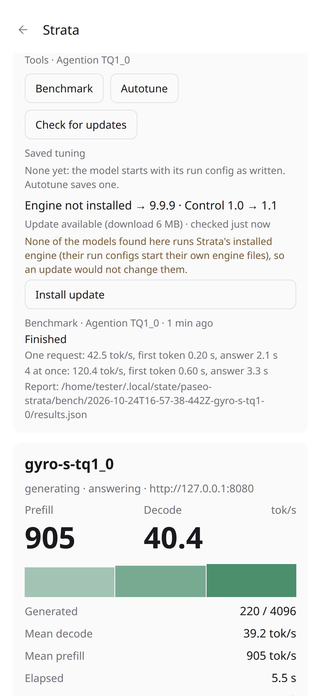

# Strata for Paseo 0.2.0

Load, stop, benchmark and tune your local Strata models from Paseo, on your desktop or your phone.

0.1.0 showed a running Strata server's speed. 0.2.0 finds every Strata model on the machine and controls it:

- **Pick a model and press Load.** Abort cancels a load, Stop ends a model. Loading one stops the other first,
  because each needs the whole GPU.
- **Benchmark** the running model: tokens per second and time to the first token, alone and 4 at once.
- **Autotune** finds the fastest settings for your PC (about 20 minutes) and saves them; Strata uses them at
  every start, so you tune once per model. If the model was running, you also see its speed before and after.
- **Saved tuning** shows which tune a model starts with, and lets you switch it off, undo, delete, or re-check
  that it is still as fast.
- **Check for updates / Install update / Undo update** for Strata's engine, from its signed feed.
- **Server log**: the last lines a model wrote; it opens by itself when a load fails.
- **Idle stop** (optional): frees the GPU after 15 to 120 minutes without requests.



## Install or update

```bash
paseo plugin add git:delirious6423/paseo-strata-monitor
```

Requires Paseo 0.12.0 or later and a Strata install. Linux, Windows and macOS; systemd service control is Linux
only. Already installed: update the plugin in Paseo's Settings → Plugins, or run the command again.

## Good to know

- Models are found where Strata keeps them (its settings file, `STRATA_INSTALL_DIR`, the desktop app's install),
  plus your own systemd user services on Linux and any folders you add. Nothing is copied or changed.
- Models outside systemd start through Strata's own CLI with profiles named `paseo-<model>-<hash>`; delete them
  in Strata's profile folder to undo.
- An autotune result is only used by a server with Strata's preset support; the screen warns when a model's
  server lacks it.
- Every autotune saves a preset, also when nothing changed ("(2)", "(3)"); delete extras under Saved tuning.
- The before/after speed is a rough check: the same quick benchmark a few minutes apart. Changes under 10% are
  shown as "no clear change", because separate runs of the same settings differed by up to 9%.
- Install update installs into Strata's component folder. Models whose run configs start their own engine
  files are not affected, and the screen says so.
- The update check contacts Strata's update feed (through Strata's CLI); everything else stays on this machine
  and the servers you add.

## Tested

- 43 unit tests; 38 end-to-end checks in throwaway VMs on Linux x64, Linux ARM64, Windows x64, Windows ARM64
  and macOS ARM64, against a stand-in Strata CLI and server.
- On a real Strata (RTX 4090 Laptop, Gyro-S model): load ready in 40 s, abort, benchmark (66.1 tok/s alone),
  autotune to completion with before/after, autotune cancel, saved tuning read/delete/apply, update check.
- Outside review by Claude Fable 5.1 and GPT-6 Astra, 2 to 3 rounds per feature set; findings fixed with
  regression tests, except two kept as known limits (systemd-run models use the first Strata install's CLI;
  Windows Cancel ends the process tree).

Full list of changes: [CHANGELOG.md](../../CHANGELOG.md).
